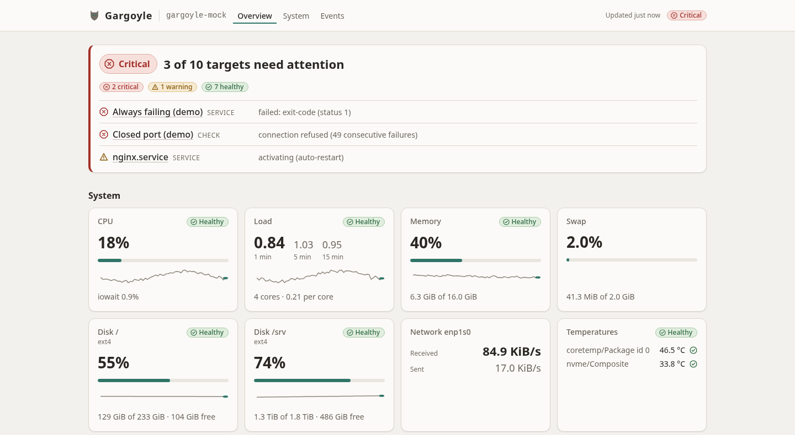
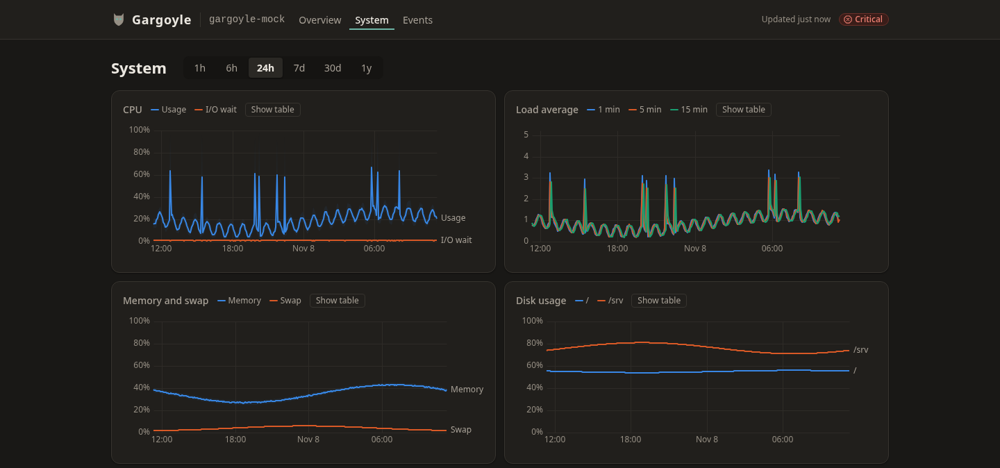
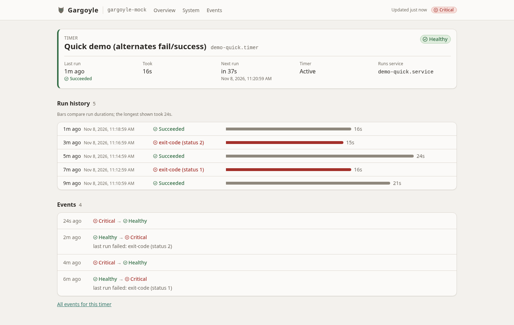
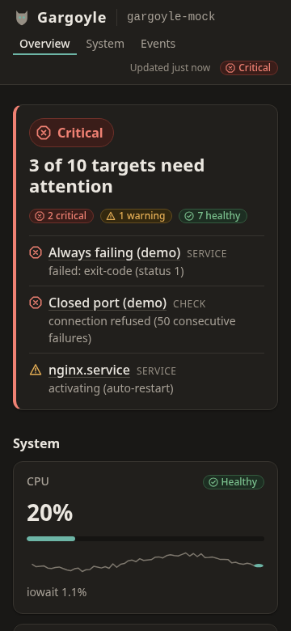

# Gargoyle

Gargoyle is a small, read-only monitoring dashboard for one personal Linux server. It is a single
Rust binary with an embedded SQLite database and an embedded web UI: no agents, no exporters, no
external database. It shows the host's system metrics, the systemd services and timers you care
about, and a few HTTP/TCP checks, and keeps their history.



## Features

- **System metrics:** CPU (with iowait), load average, memory, swap, disk usage per mount, network
  throughput per interface, temperatures and uptime, read straight from `/proc` and `/sys`.
- **Services:** state of the configured systemd services (`systemctl show`), with restart counts,
  memory use and recent events.
- **Timers:** last and next run, result and duration of each configured timer, with a run history
  that can be backfilled from the journal.
- **Checks:** HTTP(S) and TCP probes with latency thresholds and consecutive-failure counting.
- **History:** charts for 1h, 6h, 24h, 7d, 30d and 1y. Full-resolution samples are kept for 48 hours
  and 5-minute rollups for 400 days by default.
- **Events:** a log of every health change, filterable per target.
- **Health:** every target is healthy, warning, critical or unknown with a short reason, rolled up
  into one overall state (rules in [ARCHITECTURE §8](docs/ARCHITECTURE.md#8-health-model)).
- **Access:** binds to localhost by default, with optional HTTP Basic auth (argon2id), strict
  security headers and request limits.
- **Deployment:** a `.deb` with a hardened systemd unit (`systemd-analyze security` exposure 1.6)
  that runs as an unprivileged `gargoyle` user.
- **UI:** light and dark themes, responsive down to phone width, keyboard accessible, and under
  150 KB of gzipped JavaScript.

| System history (dark) | Timer with run history | Phone (dark) |
|---|---|---|
|  |  |  |

The screenshots show the built-in mock collector, which generates demo data.

## Quick start: development

Prerequisites:

- Rust 1.85 or newer (the workspace `rust-version`), with `cargo`, `rustfmt` and `clippy`.
- Node.js 20.19+ or 22.12+ (required by Vite), and pnpm 12 (the version pinned in
  `web/package.json`).
- Linux. The mock mode needs no systemd; `make run-local` reads the real host.

```sh
git clone <repository-url> gargoyle && cd gargoyle
make dev
```

`make dev` installs the web dependencies on first use, starts the backend with the mock collector
(`config/gargoyle.dev.toml`, API on `127.0.0.1:9077`, database in `./data/`) and the Vite dev
server, which proxies `/api` to it. Open the URL Vite prints (usually `http://localhost:5173`).
Mock mode backfills seven days of history into an empty database at startup, so the charts are
filled right away.

Other targets (all run from the repository root; the `Makefile` is the source of truth):

| Command | What it does |
|---|---|
| `make check` | Everything that must pass before a hand-off: `cargo fmt --check`, clippy with `-D warnings`, `cargo test`, svelte-check, vitest, prettier, the web build and the bundle size check |
| `make test` | Rust and web tests only |
| `make fmt` | Formats Rust and web sources |
| `make run-local` | The real Linux collector on this machine, read-only (`config/gargoyle.local.toml`, override with `LOCAL_CONFIG=...`) |
| `make build` | Debug binary with the embedded UI: `target/debug/gargoyle --config config/gargoyle.dev.toml` serves the dashboard on `http://127.0.0.1:9077` |
| `make test-live` | The `#[ignore]` smoke tests against the local host |

## Quick start: deployment

[docs/DEPLOYMENT.md](docs/DEPLOYMENT.md) is the full guide: requirements (Debian 12+, systemd
252+), glibc compatibility and the static musl build, installing, authentication, reverse proxy
examples, journal access, upgrades, backups and troubleshooting. In short:

```sh
make release   # -> target/x86_64-unknown-linux-gnu/release/gargoyle
make deb       # -> target/debian/gargoyle_<version>-1_amd64.deb (needs cargo-deb)
```

Install the package on the server, list your services, timers and checks in
`/etc/gargoyle/gargoyle.toml`, and restart the `gargoyle` service.

## Configuration

Gargoyle reads one TOML file (`/etc/gargoyle/gargoyle.toml`, or `--config <path>`). Every key is
optional, unknown keys are errors, and `gargoyle --config <path> check-config` reports every
problem at once.

- [docs/CONFIG.md](docs/CONFIG.md): the complete reference, checked against the code by a test.
- [config/gargoyle.example.toml](config/gargoyle.example.toml): a documented example.
- [config/gargoyle.dev.toml](config/gargoyle.dev.toml): the mock-mode config used by `make dev`.

## Security model

- **Read-only.** The HTTP server has GET routes only. Gargoyle runs `systemctl show` and read-only
  `journalctl` with fixed argument vectors, never through a shell, and neither the config nor the
  API can start, stop or run anything. There are no control operations.
- **Localhost by default.** It listens on `127.0.0.1:9077`. Binding another address without auth
  is refused at startup unless explicitly allowed (for example on a VPN interface).
- **Basic auth.** Optional, against an argon2id hash, with rate-limited guessing. TLS comes from a
  reverse proxy or a private network; Gargoyle does not terminate it.
- **No secrets in responses.** Only whitelisted systemd properties are read (never `ExecStart` or
  `Environment`), and check URLs are shown without credentials or query strings.
- **Least privilege.** It runs as its own unprivileged user under a hardened systemd unit.

Details: [ARCHITECTURE §9](docs/ARCHITECTURE.md#9-security-model) and
[ADR 0005](docs/decisions/0005-auth-and-exposure.md).

## Project layout

```
crates/gargoyle-core/       pure logic: config, health, rates, API DTOs
crates/gargoyle-collector/  Collector trait, Linux and mock collectors, /proc and systemctl parsers
crates/gargoyle/            the binary: CLI, scheduler, storage, checks, HTTP, auth, embedded UI
web/                        Svelte 5 + Vite + TypeScript frontend, built into web/dist and embedded
config/                     development, local and example configs
packaging/                  systemd unit and Debian package files
docs/                       documentation (below)
```

## Documentation

| Document | Contents |
|---|---|
| [ARCHITECTURE.md](docs/ARCHITECTURE.md) | Design, API contract, health model, security model, testing strategy |
| [ROADMAP.md](docs/ROADMAP.md) | Milestones and task IDs |
| [decisions/](docs/decisions/) | Architecture decision records |
| [api/](docs/api/) | API example payloads (part of the contract) |
| [DEPLOYMENT.md](docs/DEPLOYMENT.md) | Building, installing and running on a server |
| [CONFIG.md](docs/CONFIG.md) | Configuration reference |
| [ACCESSIBILITY.md](docs/ACCESSIBILITY.md) | Accessibility checks and manual checklist |
| [KNOWN_ISSUES.md](docs/KNOWN_ISSUES.md) | Known issues and accepted limitations |
| [AGENTS.md](AGENTS.md) | Conventions for contributors and coding agents |

## License

MIT; see [LICENSE](LICENSE).
